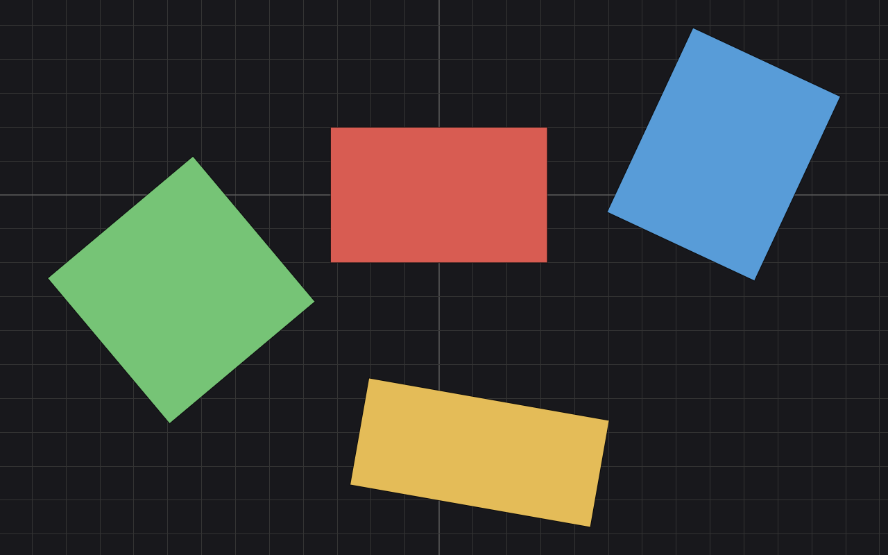

# LazyRef

A free image reference board that reads and writes PureRef `.pur` files. Android-first, in Rust.

[](https://github.com/achrllrogia45/LazyRef/actions/workflows/ci.yml)
[](LICENSE)
[](https://www.rust-lang.org)

LazyRef is an open-source reference board: you throw images onto a canvas, arrange them, and keep them around while you work. It speaks PureRef's `.pur` scene format directly, so boards made on the desktop open on your phone and back. File in, file out.

**Android is the target.** What exists today is the format core and a small desktop harness used to develop and test the board logic. The Android app is the next milestone.



## Status

| Piece | State |
|---|---|
| `purcore` — read/write PureRef 2.x `.pur`, read legacy v1.x | Done, tested against a golden corpus |
| Board core + dev harness (egui desktop) | Pan/zoom prototype, development tool only |
| Android app | Next milestone |

Nothing here is a finished consumer app yet. The format layer is the part that's done and load-bearing.

## What works

- **Reads PureRef 2.x `.pur`** scenes (SQLite-based container), including images, transforms, groups, strokes, notes and metadata.
- **Writes them back byte-for-byte identical.** On our golden-corpus tests, a scene that round-trips through the reader and writer produces the exact original file, checksum included.
- **Reads legacy v1.x `.pur`** files (the older binary format), read-only.
- **Board canvas** with cursor-pinned zoom, panning, and sticker transforms that follow the same semantics as PureRef boards.
- No Qt, no C++ runtime. The core crate pulls in `rusqlite` (bundled SQLite) and `md-5`, and that's it.

## Building

You need [Rust](https://rustup.rs) (stable). Nothing else for the core.

```bash
cargo test -p purcore     # format core: container, blobs, SQLite, legacy reader
cargo test -p lazyref     # board camera + sticker-transform invariants
cargo run  -p lazyref     # development harness (needs a display; works under xvfb-run)
```

The test suite includes golden `.pur` scenes captured from real boards, so the format tests exercise real files, not synthetic ones.

## Layout

```
crates/purcore    .pur format core — container codec, blob codecs, SQLite store, legacy reader
crates/app        board app (egui) — the Android target will reuse this core
docs/FORMAT.md    what actually lives inside a .pur file
```

## The `.pur` format

`docs/FORMAT.md` documents the container layout, the scene schema, and the binary codecs, as implemented and verified by `purcore`'s test suite.

## Roadmap

- [ ] Android app — native board UI, open/save `.pur` through the system file picker, share intents
- [ ] Render image stickers from `.pur` scene data in the board (today the harness draws placeholders)
- [ ] Save-back flow in the app (the core can already write; the app needs the UX around it)
- [ ] Desktop builds (no timeline — Android comes first)

## Credits

LazyRef builds on the work of two projects and thanks both:

- [PureRef-format](https://github.com/FyorDev/PureRef-format) — a Python toolkit for `.pur` files; our reference for format behavior.
- [DroidRef](https://github.com/Ruin0x11/DroidRef) — the Android reference-board app this project is a Rust rewrite of; the board interaction model follows it (including its sticker canvas, adapted from [StickerView](https://github.com/wuapnjie/StickerView)).

LazyRef is not affiliated with PureRef or its authors. "PureRef" is mentioned only to describe file-format compatibility.

## License

MIT — see [LICENSE](LICENSE).
